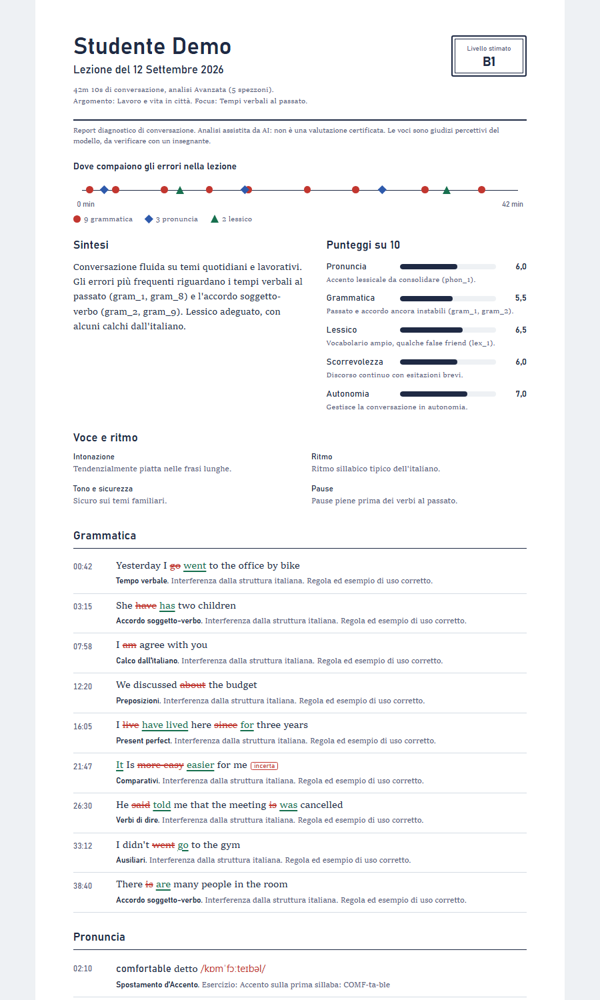
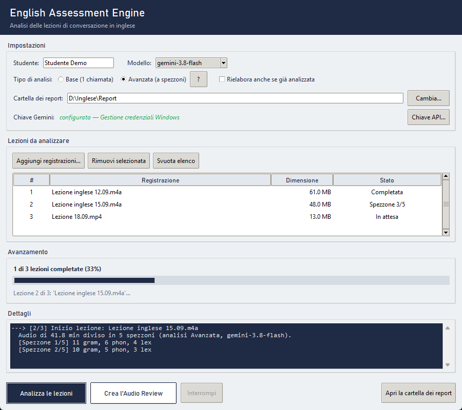

# English Assessment Engine

Analizza le registrazioni delle tue lezioni di conversazione in inglese con Google Gemini e produce un report di studio: ogni errore è la frase che hai detto, con la correzione scritta sopra come farebbe un insegnante.

*An app for Italian learners of English: it analyses recorded conversation lessons with Google Gemini and produces a study report with every mistake corrected in place. The interface and reports are in Italian.*

[](https://github.com/f-estero/english-assessment-engine/actions/workflows/tests.yml)


[](LICENSE)

<p align="center"></p>

## Cosa fa

- **Corregge le frasi che hai detto davvero.** Grammatica, pronuncia (con trascrizione IPA) e lessico, ciascuna voce con il minuto della registrazione.
- **Copre tutta la lezione.** In modalità Avanzata l'audio viene diviso in spezzoni da 10 minuti: nelle nostre prove le voci trovate sono circa 4 volte di più e distribuite su tutta la lezione, invece di concentrarsi sui primi 15-20 minuti.
- **Tiene traccia dei progressi.** Punteggi, errori che si ripetono e andamento nelle ultime lezioni, separati per studente.
- **Crea un ripasso audio.** Una traccia MP3 con voci madrelingua britanniche che leggono le correzioni e lasciano la pausa per ripeterle (shadowing).
- **Esporta tutto.** Report HTML e PDF, `errori.csv` con tutte le voci, `report.json`.

<p align="center"></p>

## Come iniziare

### 1. La chiave Gemini

Serve una chiave API di Google Gemini, che si crea gratis su [Google AI Studio](https://aistudio.google.com/apikey). Al primo avvio l'app la chiede e la salva cifrata nella Gestione credenziali di Windows: non finisce in nessun file.

### 2. L'app

**Con l'eseguibile** (consigliato): scarica `AssessmentEngine.exe` dalla pagina [Releases](https://github.com/f-estero/english-assessment-engine/releases), avvialo, poi tasto destro sull'icona nella barra delle applicazioni → *Aggiungi alla barra delle applicazioni*.

**Dai sorgenti** (Python 3.10 o superiore):

```bash
git clone https://github.com/f-estero/english-assessment-engine.git
cd english-assessment-engine
pip install -r requirements.txt
python generate_report.py
```

Al primo avvio l'app chiede anche la cartella in cui salvare i report; si può cambiare quando vuoi con *Cambia…*.

### 3. Analizzare una lezione

1. *Aggiungi registrazioni…* e scegli i file (`.m4a`, `.mp3`, `.mp4`, `.wav`, `.aac`, `.ogg`, `.flac`). Dagli MP4 con video viene usata solo la traccia audio.
2. Scegli il tipo di analisi (il pulsante **?** spiega le differenze).
3. *Analizza le lezioni*. A fine analisi *Apri la cartella dei report*.

Conviene che il nome del file contenga la data della lezione (`Lezione inglese 12.09.m4a` o `2026-09-12 lezione.m4a`): serve per la data del report, la cartella del mese e l'ordine dell'andamento.

## Base o Avanzata

| | **Base** | **Avanzata** |
|---|---|---|
| Chiamate a Gemini per lezione | 1 | circa 1 ogni 10 minuti + 1 di sintesi (45 minuti ≈ 6) |
| Parte di lezione analizzata | soprattutto i primi 15-20 minuti | tutta la lezione |
| Adatta a | piano gratuito di Gemini | piano a pagamento o limiti giornalieri ampi |
| Tempo | circa 1 minuto | 1-2 minuti |

I limiti della tua chiave sono in Google AI Studio → *Usage* / *Rate limits*. *Rielabora anche se già analizzata* rianalizza le lezioni che hanno già un report.

**Modelli.** Il predefinito è `gemini-3.8-flash`, il più veloce nelle nostre prove, con risultati coerenti con 3.5 Flash e Pro. Se il modello scelto non risponde, l'app passa automaticamente ai successivi (3.7, 3.6, 3.5 Flash, flash-latest, pro-latest, 2.5 Flash).

## Dove finiscono i file

```
<cartella dei report>/
├── Settembre 26/
│   └── 2026-09-12_Mario_Lezione_inglese_12_09/
│       ├── Report_….html / .pdf       il report da leggere
│       ├── errori.csv                 tutte le voci, apribile con Excel
│       ├── report.json                i dati completi
│       ├── Audio_Review_….mp3         se creato
│       └── Lezione inglese 12.09.m4a  copia della registrazione
└── sessions.jsonl                     storico per l'andamento
```

Il PDF mostra le voci più affidabili distribuite su tutta la lezione (fino a 20 di grammatica, 12 di pronuncia, 10 di lessico); il CSV le contiene tutte.

## Riga di comando

```bash
python generate_report.py --audio "Lezione inglese 12.09.m4a" --mode avanzata
python generate_report.py --audio lezione.m4a --student-name Mario --output-dir "D:\Report" --force
python generate_report.py --audio lezione.m4a --audio-only           # solo l'Audio Review
python generate_report.py --from-json "…\report.json"                # rigenera HTML/PDF senza chiamate
```

Da riga di comando la chiave si può dare anche con la variabile d'ambiente `GEMINI_API_KEY` o con un file `.env` (vedi `.env.example`); entrambi hanno la precedenza sulla chiave salvata dall'app.

## Privacy

- La registrazione viene caricata sui server di Google per l'analisi e cancellata subito dopo. Si applicano i [termini di Gemini API](https://ai.google.dev/gemini-api/terms): con il piano gratuito Google può usare i dati per migliorare i propri prodotti.
- L'Audio Review usa il servizio di sintesi vocale online di Microsoft Edge (libreria `edge-tts`, non ufficiale): vengono inviate solo le frasi corrette, non l'audio.
- Report, storico e registrazioni restano nella cartella che scegli tu. Contengono dati personali: non metterli in una repository pubblica.
- L'app funziona anche dietro antivirus o proxy che ispezionano HTTPS (es. Norton) perché usa i certificati di sistema.

## Limiti

I risultati sono giudizi percettivi di un modello AI, non misurazioni: le citazioni e le correzioni vanno verificate e il livello CEFR è una stima, non una certificazione. Le voci con confidenza bassa sono segnate come *incerta*.

## Sviluppo

```bash
pip install -r requirements-dev.txt
python -m pytest
.\build.ps1 -Shortcut        # crea dist\AssessmentEngine.exe e un collegamento sul Desktop
```

I test non fanno chiamate di rete. Per contribuire leggi [CONTRIBUTING.md](CONTRIBUTING.md); per le chiavi e la sicurezza [SECURITY.md](SECURITY.md).

## Licenza

[MIT](LICENSE)
